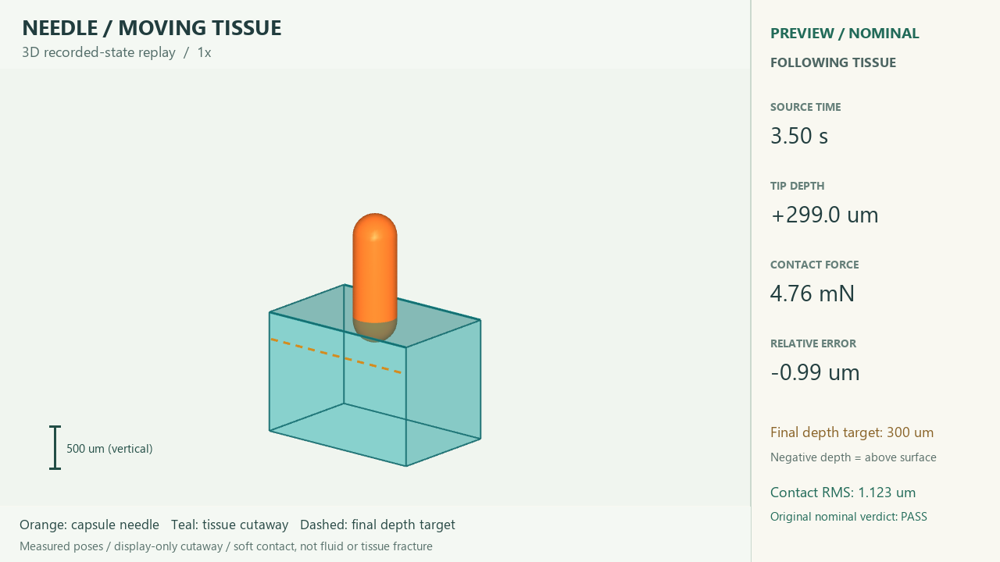
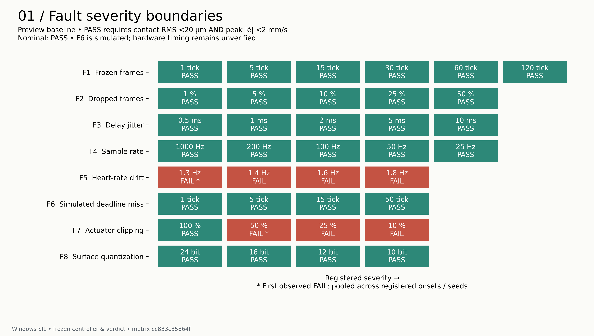
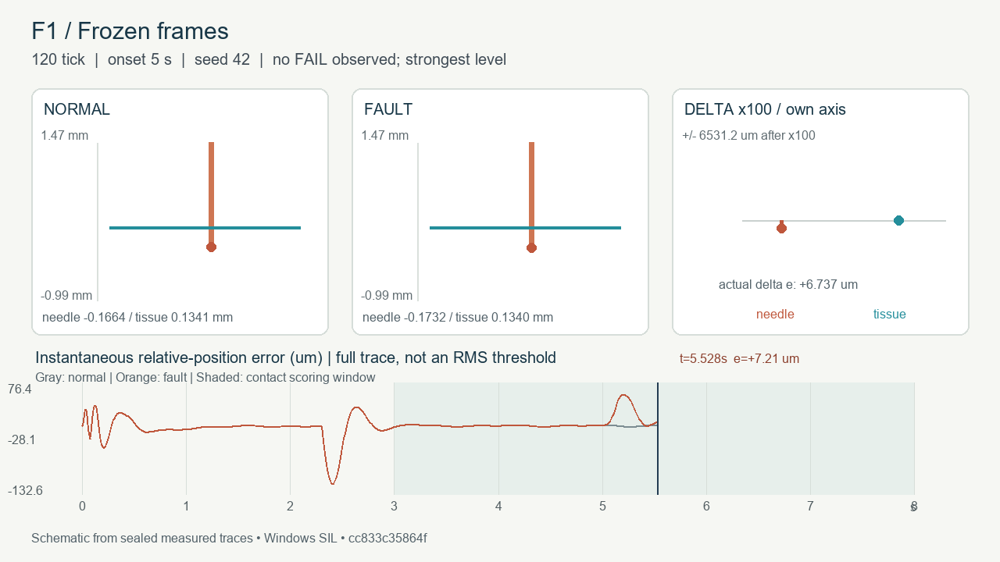
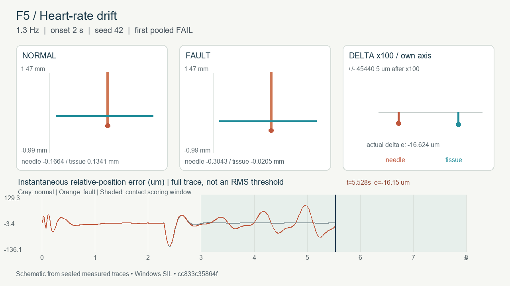
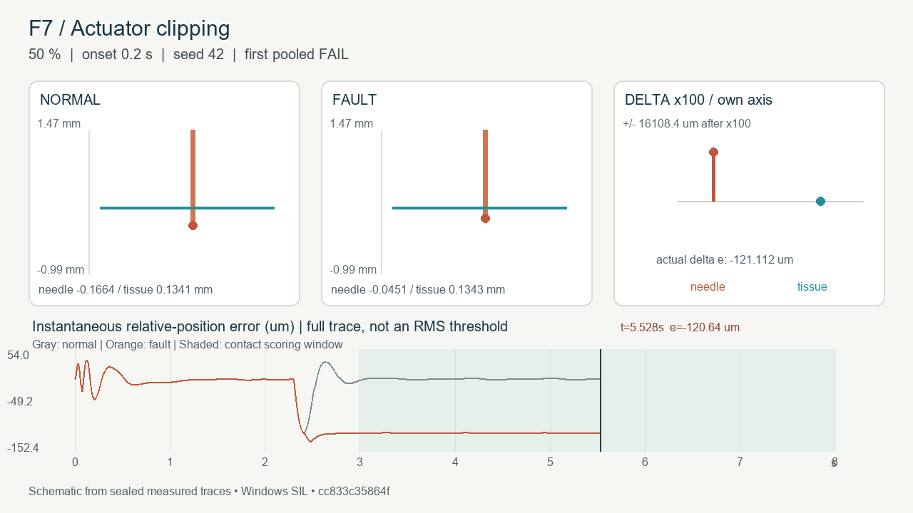
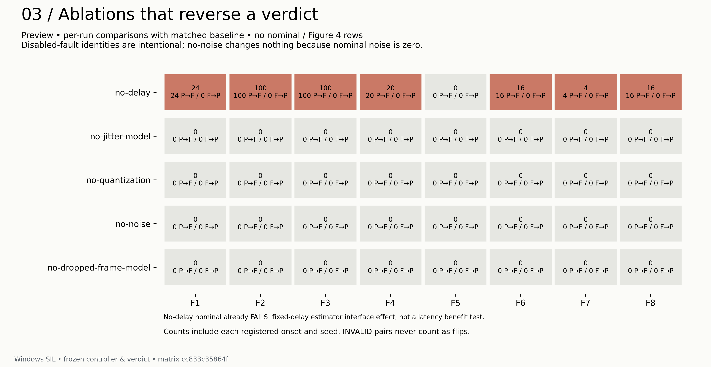

# 把预测留在结果之前

这是一个持续更新的项目记录：保留问题、预注册、失败、审阅和解释的变化。
当前完成的是 Phase C 的 **SIL 软件部分**；真实板上 HIL 尚未实测。

完整图文视频文章在 [blog.html](../artifacts/c1/blog.html)。GitHub 的文件页显示
HTML 源码；克隆 `phase-c-sil` 分支后，在仓库根目录运行：

```text
python -m http.server 8765 --bind 127.0.0.1 --directory artifacts/c1
```

然后在浏览器打开 `http://127.0.0.1:8765/blog.html`。页面也可以离线直接打开，
视频无自动播放，所有媒体都在仓库里。这里是适合在 GitHub 阅读的文字入口。

## 先看针插入组织的三维场景

[](../artifacts/c1/videos/insertion-3d.mp4)

[打开三维视频](../artifacts/c1/videos/insertion-3d.mp4)：先播放完整 8 秒，再用 4 秒
以 0.25 倍速回看源时间 2–3 秒的插入过程。橙色是原模型的胶囊形针，青色是组织
显示剖视；右侧显示源时间、针尖深度、接触力和误差。位置均来自封存 nominal
轨迹，没有重跑控制器或积分物理。该模型是简化软接触块，不模拟液体或组织撕裂。

[渲染清单](../artifacts/c1/insertion-3d-manifest.json) 记录源 run、哈希与慢放时序。
图文版开头直接嵌入播放器，下面的八段故障视频继续用于分析对照。

## 从一个已经通过的控制器开始

MuJoCo 模拟一根沿单轴运动的针，以及周期起伏的组织表面。控制器接收带延迟的
测量，尝试保持目标相对插入深度。固定频率 preview 在 nominal 下的接触 RMS
约为 1.12 µm。后续问题是：当传感器、组织频率或执行器输出偏离 nominal 时，
仿真的通过还能保持多少？真实 MCU 以后会不会给出同样结论？

这个阶段保持控制器和阈值不变。3,615 个逻辑场景各尝试两次，得到 2,730 PASS、
789 FAIL、96 INVALID。计数包含两种精度、六种消融及旧控制器对照，不能作为
preview 单一故障的通过率。3,519 个场景完整复现；不完整记录仍保留为 INVALID。

## 先留下预测，才有结果可以对照

[预注册](C1_PREREG.md) 固定了档位、时刻、随机种子、消融和五条预测。
一次 run 是 8 秒；接触评价窗口为 3–8 秒。判定要求接触 RMS <20 µm 且
峰值误差速度 <2 mm/s。看到结果后没有更改原预测或重新调参。

| 原预测 | 实验对照 |
| --- | --- |
| F4：25 Hz 会 FAIL | 不支持，四个 onset 仍 PASS |
| F5：≥1.6 Hz 会 FAIL | 支持，最轻的 1.3 Hz 已 FAIL |
| F1：≥60 tick 冻结会 FAIL | 不支持，60/120 tick 的八个场景仍 PASS |
| 瞬态故障在 2.4 s 注入最差 | 不支持；F1 在 5 s 明显更差，F2/F3 近乎平坦 |
| no-delay 消融翻转最多 | 结构性支持，解释受帧龄 guard 限制 |



## 三段视频里的过程

视频来自封存轨迹，均为 8 秒，不是真实硬件录像。三栏是正常、故障、差值 ×100，
下方是误差曲线；差值面板单独标注尺度。图文版直接嵌入播放器，下面链接可打开 MP4。

### F1：仍然 PASS，但余量变小

120 tick 冻结在 5 秒发生时，接触 RMS 为 13.318 µm；2.4 秒发生时为 4.763 µm。
同一个 PASS 并没有抹平时机造成的差别。

[](../artifacts/c1/videos/F1.mp4)

### F5：最轻的频率漂移已经失败

组织基频在 2–5 秒从 1.2 Hz 变至 1.3 Hz，预测器频率不变；RMS 达到 52.684 µm。
这个 FAIL 留下了固定频率模型的局限。

[](../artifacts/c1/videos/F5.mp4)

### F7：平稳地停在错误深度

0.2 秒开始限幅到 nominal 指令峰值的 50%，RMS 为 120.485 µm，而峰值误差速度
约 0.0091 mm/s。稳定运动不代表深度正确。若到 5 秒才限幅，还会发生明显瞬态，
所以不能把所有 F7 失败都称为静态偏差。

[](../artifacts/c1/videos/F7.mp4)

这些是已测试离散档位中的观察，不是连续物理边界。F7 onset 平局取最早时刻是
事后展示约定，已单独记录。其余视频：
[F2 丢帧](../artifacts/c1/videos/F2.mp4)、[F3 抖动](../artifacts/c1/videos/F3.mp4)、
[F4 采样率](../artifacts/c1/videos/F4.mp4)、[F6 跳过调用](../artifacts/c1/videos/F6.mp4)、
[F8 量化](../artifacts/c1/videos/F8.mp4)。

## 审阅改变了解释，也改善了证据的表达

- no-delay 确实有 280 次 PASS→FAIL 翻转，但 nominal 本身已经违反冻结估计器的
  15 ms 帧龄 guard。这不能证明低延迟有害，也不能证明延迟建模的必要性。
- “F2/F3/F8 变化都小于 2 nm”的审阅意见经过逐场景复核，改为 2.52/8.21/3.32 nm。
  这是接触 RMS 指标的最大绝对变化，不是瞬时位置误差上界。
- 1,782 对 Python/C32 场景中，1,686 对有效并且 verdict 全部一致；96 对因 C32
  拒绝跳号 tick 而 INVALID。C32 F6 覆盖是 0/96，不能从一致率里省略这一点。
- 图中补上 RMS 余量、保留重叠曲线说明，校验器在 `python -O` 下仍能拒绝篡改。
  视频轴标签和交付链接也经过修正。全部原反馈与处理理由在 [reviews](../reviews)。



## 保存过程的几个节点

| 节点 | 留下的内容 |
| --- | --- |
| G / M0 | 约束、评审流程、预注册和运行前修订 |
| M1 | 独立注入层、Python/Rust 语义对照 |
| M2 | 全矩阵、重复记录、失败和无效覆盖、预测对照 |
| M3 | 只读封存轨迹制作图、视频和热图 |
| M4 | 报告、短文、审阅纠正和最终封存 |
| 本次记录扩写 | 把图文视频串成过程文章，补 GitHub 阅读入口和 HIL 待补清单 |

封存提交：[8f5dacad](https://github.com/Jeffaaay/insertion-vv/tree/8f5dacad219366b4bfe32caf9a5f8a862633b768)。
后续文章修订保留版本；矩阵与原轨迹不因叙事更新而重跑或改写。

## 硬件篇：等待真实记录

计划让 NUCLEO-H723ZG 运行冻结 C32，MuJoCo 继续模拟被控对象。固件和工具的准备
不等于板上验证完成，MCU HIL 也不等于实体针或临床验证。
nominal 链路与计时沿用 [硬件 runbook](HARDWARE_RUNBOOK.md) 和 [已有硬件计划](PHASE_B_HARDWARE_PLAN.md)。
故障注入 HIL 工具尚未实现，不能直接按 runbook 执行全部故障。

| 将来补入的材料 | 工具状态 | 实验状态 |
| --- | --- | --- |
| 板子、PC、仿真连接的实拍照片和短视频 | 待整理拍摄材料 | 未拍摄 |
| nominal 链路与 compute p99、overrun、jitter p99、栈余量 | 已有 runbook、lockstep/replay 与分析工具 | 未测量 |
| F1/F5/F7 同场景 SIL/HIL 判定与数值差异 | HIL 注入路径待开发；Rust 注入器目前仅做离线语义对照 | 未运行 |
| F6 真实 MCU deadline miss 与现有覆盖缺口 | 受控负载或单独记哈希的实验固件变体待开发 | 未验证 |
| F9 CRC 和 F10 板子/PC 时钟漂移 | 链路帧损坏与时钟漂移记录工具待开发 | HIL-only |

lockstep 由主机推进，主要检查 MCU 与 host C32 的数值一致性，不是实时性验证。
1,686 对有效软件场景的一致性提供了对照基线，板上结果仍待测量。独立 replay
的计时、真实 F6、链路/时钟故障必须分别留下证据。

既有门槛是 compute p99 <100 µs、overrun = 0、jitter p99 <5 µs、栈余量 ≥4 KiB，
均为待检验目标。硬件回来后，保留首次差异和失败的材料，再追加解释与修复记录。
公开照片和材料应去除板子 UID、探针序列号等设备标识；不发布原始 Flash 备份。

## 数据与复核

[一页报告](PHASE_C_SIL_SUMMARY.md) · [发现及解释](FINDINGS.md) ·
[全部媒体](../artifacts/c1) · [复现说明](../c1/README.md)

完整轨迹 ZIP（约 3.79 GB）仅本地交付，公开仓库保留
[SHA-256](../artifacts/c1/evidence-runs.sha256) 与
[9 个参考 run 的轨迹](../artifacts/c1/selected-traces.zip)。
在仓库根目录运行 `python -m c1.verify_public` 可校验公开产物和参考轨迹。

矩阵 SHA-256：`cc833c35864f0f8cfa4d67671bf605a129c2b18a5f59710be41ee11e2eb98aa9`。
